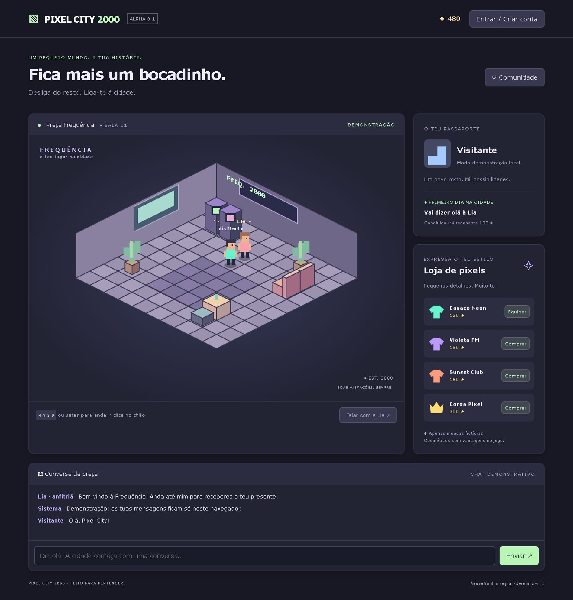

# Pixel City 2000 · Alpha 0.1

Jogo web social isométrico com identidade e desenho originais. MVP local, sem dependências externas nem cobranças reais. Requer **Node.js 22 ou superior**.



## O que é este projeto?

Pixel City 2000 recupera a sensação dos pontos de encontro virtuais dos anos 2000 com uma identidade própria: uma praça isométrica, cores suaves, máquinas arcade, personagens em pixels e conversa entre jogadores. Esta primeira versão permite explorar a sala, conhecer a anfitriã Lia, receber um presente de boas-vindas e personalizar o avatar com moedas fictícias.

O objetivo é evoluir para um mundo social online sustentável, onde os cosméticos ajudam a financiar o desenvolvimento sem oferecer vantagens competitivas. Este repositório entrega uma base executável: interface, servidor autoritativo, contas locais, persistência, moderação e testes. A abertura ao público e os pagamentos são etapas futuras, sujeitas à infraestrutura e validações descritas abaixo.

## Jogar

Na pasta do projeto, executar:

```sh
npm start
```

Abrir **http://localhost:3000**. Também podes usar `node server.mjs`. Em Windows, `JOGAR.cmd` inicia o servidor e abre o navegador.

- Andar: WASD, setas, botões no telemóvel ou clique num quadrado do chão. Os móveis bloqueiam a passagem.
- Aproxima-te da Lia e carrega em **Falar com a Lia**: recebes 100 moedas uma única vez.
- Começas com 500 moedas fictícias. Compra e equipa casacos ou uma coroa.
- Sem conta, tudo é demonstração temporária no navegador; recarregar repõe o estado.
- Cria uma conta com nome e palavra-passe de pelo menos 12 caracteres para guardar o progresso. Não uses uma palavra-passe de outro serviço neste protótipo.
- Para experimentar duas pessoas, usa dois perfis de navegador e duas contas. O servidor partilha a sala e o chat, atualizados a cada 1,5 segundos. Não há utilizadores simulados apresentados como pessoas reais.
- O servidor escuta apenas na máquina local por predefinição. Não está publicado na Internet.

## Administração e moderação

1. Cria a tua conta pelo jogo.
2. Para o servidor com Ctrl+C.
3. Executa `node admin.mjs "Nome da conta"`.
4. Reinicia o servidor e entra na conta. Em **A minha conta**, abre **Painel administrativo**.

A promoção exige acesso ao computador/ficheiros; não existe palavra-passe administrativa incluída no código nem promoção por pedido do navegador. Não executar a ferramenta enquanto o servidor estiver ativo.

Uma mensagem de outra conta pode ser denunciada. A denúncia guarda uma cópia da mensagem e o motivo. Um administrador pode emitir aviso, mute de 30 minutos, suspensão de 24 horas ou levantar restrições. Cada medida exige justificação e fica registada. O jogador consulta medidas em **Comunidade** e envia recurso, mesmo suspenso. O administrador aceita ou rejeita com justificação. Aceitar levanta as restrições ativas da conta; esta simplificação deverá ser substituída por revogação individual de medidas na próxima versão.

O filtro de três termos e de links é uma demonstração limitada, não um sistema completo de deteção de abuso. Não emite banimentos automáticos. A interface não inclui ainda bloqueio pessoal, filas com atribuição de denúncias, nem banimento permanente.

## Testes

```sh
npm test
```

Testes de integração com servidor e dados isolados: criação/login, autorização administrativa, origem e CSRF, rejeição de movimento impossível, compra concorrente sem débito duplicado, persistência, denúncia, mute, suspensão, recurso, levantamento de restrições e logout.

## Estrutura e limites

- `public/`: interface sem bibliotecas, sala desenhada em Canvas, estilos e catálogo. O cliente envia intenções de movimento/artigo, nunca saldo ou preço autoritativos.
- `server.mjs`: API HTTP autoritativa; valida cada passo, colisões, cadência, saldo, inventário, missão e sanções. Estado partilhado por polling, sem ligações P2P/WebRTC.
- `data/state.json`: contas, inventário e moderação; escrita serializada e substituição por rename. Criado no primeiro arranque, excluído do controlo de versões. Um processo por ficheiro. Não é uma base transacional para produção.
- Sessões em memória, expiração de 24 horas, cookie HttpOnly/SameSite=Strict, token CSRF e verificação de Origin. Reiniciar termina as sessões. Palavras-passe com scrypt assíncrono e salt individual; não guardadas em texto simples. Sem recuperação de conta, MFA ou verificação de email nesta versão.
- Mensagens em memória (últimas 100); são perdidas ao reiniciar. Denúncias preservam a evidência. Os movimentos ficam guardados, mas posições de contas desconectadas não são enviadas como jogadores online.
- Limites de tentativas de autenticação por endereço de ligação e limites por conta para chat, movimentos e denúncias. Não existe limite global de registos/armazenamento; proteger antes de exposição pública.
- A API pública só envia os campos necessários do avatar. IPs não são enviados entre jogadores; o servidor e o futuro fornecedor de alojamento veem os endereços das ligações. Não é anonimato nem proteção absoluta.

## Próxima etapa: serviço público

Antes de lançar, migrar para PostgreSQL com transações, índice único no nome normalizado, registo contabilístico e chaves de idempotência; backups testados; sessões partilhadas; tarefas de retenção/eliminação; limites globais e por sala; logs mínimos com acesso restrito; monitorização; revisão de segurança e testes de carga. O armazenamento atual é adequado a desenvolvimento local, não a múltiplas instâncias.

Separar autenticação, sala, carteira e moderação em módulos/serviços conforme a escala. Substituir o polling por WebSocket com origem/sessão verificadas, validação de mensagens, sequência e taxa máxima por jogador. Manter simulação e colisões no servidor; adicionar interpolação visual no cliente. Distribuir salas entre processos e usar armazenamento partilhado para sessões e sanções. Nenhum cliente deve receber IPs dos outros clientes.

Usar autenticação gerida via OIDC (Authorization Code + PKCE) ou manter um serviço de identidade auditado; MFA obrigatório para administradores, recuperação de conta e revogação de sessões. Manter papéis exclusivamente no servidor. HTTPS obrigatório em produção; configurar `NODE_ENV=production` para cookie Secure e `PUBLIC_ORIGIN=https://dominio` para a origem exata. `HOST` e `PORT` controlam a escuta. Não ativar acesso externo apenas alterando HOST sem configurar as restantes proteções. Atrás de proxy, definir explicitamente a política de proxies confiáveis e rate limiting no gateway; não confiar em X-Forwarded-For arbitrário.

Pagamentos: `/api/checkout` devolve sempre 503. Integrar futuramente um fornecedor especializado com checkout alojado; segredos apenas no servidor, verificação de assinatura dos webhooks, validação de produto/montante/moeda, idempotência de evento e crédito transacional. Nunca creditar moedas pelo redirecionamento de sucesso do navegador. Prever reembolsos/estornos e reconciliação. Não recolher cartões no jogo. Nenhuma chave ou fornecedor está configurado neste MVP.

Definir regras de comunidade, escalada humana, tempos de resposta, revisão de recursos e processos de proteção de menores antes da abertura. Rever requisitos aplicáveis de privacidade, idade, consumo e pagamentos com profissionais adequados. Não há garantia de segurança absoluta.
